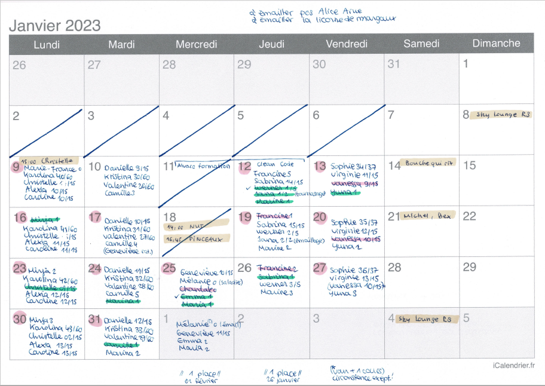

# Projet Idoloma : I DOn't Loose My Agenda

Actuellement, le planning de suivi des cours à l'atelier est 100% papier.
Sujet à erreur, difficulté de suivi.
Sujet d'actualité depuis 2021.

# Structure de l'agenda papier

Il reprend les infos suivantes :

* Chaque jour, il peut y avoir 1 cours regroupant jusqu'à 6 personnes
* Pour chaque personne, il est indiqué son état d'avancement dans son abonnement (1er cours, 2ème cours, etc)
* Pour chaque personne, un code couleur indique les paiements réalisés
   * En retard de paiement
   * Paiement réalisé online
   * Paiement réalisé cash
* D'autres occurences peuvent également être indiquées (rdv non facturés, ou facturés autrement)

# Périmètre

Il y a donc plusieurs aspects abordés :

* Le planning : Agenda des cours & des RDV, avec les personnes participant
* La gestion client : Traçage d'état d'avancement des abonnements
* La gestion des paiements : Légende indiquant le moyen de paiement utilisé
* La gestion financière : Somme des paiements réalisés (avec distingo online/cash)
   * Déterminant pour que Aurélie sache combien se verser en terme de salaire

Au-delà de tous ces aspects, Aurélie souhaiterait déléguer la gestion de ce planning à ses élèves.
Cela passe par une digitalisation du planning, et une exposition de l'état des créneaux.
Les élèves pourraient alors payer en ligne un abonnement, puis choisir les créneaux selon disponibilité.

# Situation initiale

Début 2021, Aurélie s’est faite une frayeur en oubliant où était son agenda papier.
Cela met en lumière à quel point ce document est important : Il est vital au bon déroulement de l’atelier.
Les élèves ne s’occupent pas du tout de l’avancement de leurs abonnements, et s’en remettent complètement à Aurélie pour savoir quand ils doivent de nouveau passer à la caisse.
Dans ce contexte, sans considérer déléguer la gestion des réservations aux élèves, il serait déjà bon de numériser la gestion de l’agenda tel qu’il existe déjà aujourd’hui.

* Vision sur le mois du remplissement des cours
   * Nécessité de répondre rapidement à : “Quels cours peuvent accueillir un élève?”
* Vision du décompte des cours des élèves
* Indicateur de nécessité de paiement des élèves
* Vision des rendez-vous (cours privés)

# Structure de l'agenda

## Agenda papier

* 1er cours : Surlignage
   * En jaune si l’élève n’a pas encore payé
   * En vert si l’élève a payé
* Dernier cours (n° 5/15/30/60) : Surlignage en rouge
* Surlignage en rose à élucider
* 5+ élèves sur une case : La case est grisée
* Zone de texte dédiée pour les cours privés (hh:mm nom), surlignée en orange

## Réflexion sur la structure d'un agenda digital

En terme d’interface web, on trouverait 3 écrans bien distincts.
Vision globale sur le mois :

* Affichage très simple / minimaliste
* Met en évidence quels cours ont encore de la disponibilité (< 5 personnes)
   * Indique le nombre de places encore disponibles
* Met en évidence la présence de cours privés (uniquement afficher l’heure)
* Aucune fonctionnalité d’édition

Vision affinée sur la semaine :

* Détail des participants avec leur décompte respectif
* Légendes selon situation de chaque participant (surlignage)
* Détail des cours privés
* Case grisée si participants ≥ 5
* Une seule fonctionnalité d’édition
   * Drag & drop d’une ligne de participation d’une case à une autre de la même semaine.

Vision détaillée sur une journée :

* Capacité d’édition complète sur la journée concernée
* Option de surlignage pour les élèves fantômes

Besoin particulier : Retracer toutes les dates auxquelles un élève a été présent.

# Facturation Atelier
On a 3 types de paiement :

* Ceux à l'avance : Rien n'a été consommé, tout est sur le compte
* Ceux "à l'heure" : Paiement au moment de la consommation, consommation potentiellement partielle ( 1 cours / X )
* Ceux en retard : Paiement après 2 ou 3 cours, entrées potentiellement sur le mois qui suit, ce qui représente une dette quasi systématique

Entrées effectives : L'argent qui est réellement entré sur le compte
Entrées attendues : Est-ce que tout l'argent correspondant aux prestations données a été crédité ? Et ça, c'est pas le cas.
Les besoins :
Avoir une méthode permettant une traçabilité des opérations
Avoir un moyen d'identifier les cours payés non consommés, et les cours non payés et consommés

* Au niveau de chaque client
* En total mensuel pour la comptabilité
* En total actuel pour expliquer la liquidité

Ce qu'on pourrait essayer:
Un tableur excel avec

* 1 colonne client
* 5 colonnes cours
* 1 colonne encaissement

Les colonnes cours seraient renseignées avec les dates de cours, ou vide si pas fait
Des colonnes supplémentaires permettraient de savoir l'encaissement effectif, le reste à encaisser, et le retard de paiement

# Architecture

1 cours = 0-N étudiants
1 étudiant = 0-N cours
Les cours sont des évènements uniques ou récurrents selon leur type.
Cours privé = Instance unique sur une période fixée dans la même journée.
Stages = Instance unique sur une période de plusieurs jours.
Cours de groupe = Instance récurrente sur un jour de la semaine et des heures données.
Un élève s'inscrit pour un créneau de cours de groupe donné (ex : les mardi à 17h). Il s'inscrit pour un nombre de cours donnés, qu'il doit payer (mais il peut être inscrit sans avoir payé avant).
Quand on inscrit un élève, on l'inscrit à partir d'une date donnée (première occurrence du cours), sur un créneau donné (jour + heure), pour un certain nombre de répétitions.
Cette inscription implique d'avoir le suivi financier correspondant : ce carnet de cours est-il payé?
Bien différencier les concepts :

* Cours de groupe (événement unique ayant lieu sur une plage de cours ouverte)
* Plage de cours ouverte (récurrente ou unique, active ou archivée)
* Carnet de cours (inscription d'un élève sur un nombre donné de cours, pour une plage récurrente donnée)
* Élève (personne susceptible de s'inscrire à des cours)

Plage d'événement => Événement => Inscriptions => Élèves
Cycles de vie ?
Plage & Événement sont liés l'un à l'autre.
Élève indépendant.
Inscription indépendante.
Étant donné qu'il existe la possibilité de déplacer le cours d'une élève dans la même semaine, on est obligés de matérialiser chacun des rendez-vous...
Le carnet de cours provoque l'inscription au cours. Ce qui mène à l'ajout de l'élève dans la liste des participants.
Vue qu'on peut déplacer des cours, lorsqu'on l'enregistre, on définit une stratégie et non pas des rendez-vous.. après tout, un élève inscrit pour les mardi pourrait bien avoir des cours ailleurs si déplacés.
Ce qui implique que si des plages de cours changent, il faut prendre en compte la situation de chaque élève et recalculer son droit aux cours.
Aurélie veut-elle garder une trace de la raison pour laquelle certains créneaux ne sont pas disponibles? Vacances, maladie, etc?
Ça impliquerait que les cours continueraient d'exister en base, mais changeraient de statut pour ne plus être disponibles.
On aurait donc un calcul basé sur des plages de cours, et des plages/périodrs de fermeture.
Au lieu de plages de cours, on va parler de disponibilités. Concept métier : Disponibilité/Availability
Surlignage / code couleur :

* Gens qui doivent payer (en vert)
* Gens qui ont payé (surligné vert)
* Gens qui ont payé cash (jaune)
* Gens qui sont dans un cours privé (rouge, surligné rouge)
* Cours de rattrapage (bleu)
* Cours déplacés ailleurs (barrés en bleu)

Élèves annotés avec le suivi de leur carnet de cours (numéro de cours actuel / NB de cours du carnet au total)
6 places par jour sur les cours de groupe
En dessous de 3 élèves, cours mis en évidence car peut être annulé
Cours privé affiché sous la forme "Christelle 14h"

Nom de l'app: Idoloma (Acronyme pour "I Don't LOose My Agenda)